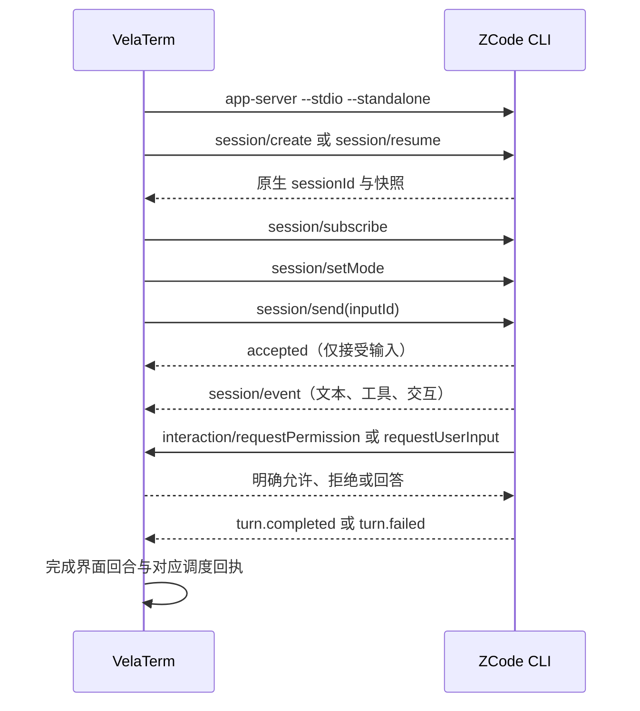

# Zcode 原生 CLI 接入

新增独立 `zcode` Harness，使用对话界面，可作为普通子智能体，以及规划、执行和审查角色参与调度。初始实现及 Windows 成品基于 VelaTerm 0.2.9；提交分支已兼容上游 0.2.10。

## CLI 前置条件

此接入要求 ZCode CLI 支持 `app-server --stdio --standalone`。`--standalone` 是配套 ZCode 源码改动提供的能力：独立装配 CLI 账户注册表与运行时请求头，不依赖 ZCode 桌面 GUI。未包含该改动的官方 CLI 版本不属于已验证范围。VelaTerm PR 需要关联这项上游依赖，不能宣称现有官方发行包均可使用。

VelaTerm 不内置账户凭据或固定模型。可在智能体设置中指定 CLI 路径；未指定时依次发现 EXE 相邻的 `zcode/zcode.exe`（Unix 为 `zcode/zcode`）及通常的安装路径。运行资源由 CLI 安装提供，不向本仓库提交 Node、CLI bundle 或第三方插件二进制。

## 状态所有权与事件顺序

ZCode CLI 拥有账户、模型配置、原生会话历史、任务执行和权限判断。VelaTerm 拥有进程生命周期、树节点到原生会话 ID 的映射，以及界面投影。一个 VelaTerm Zcode 会话使用一个独立 CLI 进程。

子会话可通过 `vspawn --zcode --model deepseek/deepseek-flash --effort max --yes "请回报模型名称并回复你好，不使用工具"` 原生派发。模型 ID 和思考档位以当前 CLI 返回的目录为准；启动菜单保留逐模型档位。保存的 `--model` / `--effort` 由宿主转换为原生会话 RPC 选择，启动 app-server 时剥离这两个参数。`--yes` 跳过初始确认，正常自动启动期间不弹确认卡；启动失败仍显示错误和显式重试入口，不能把确认跳过解释为忽略错误。



事件按原生 `sessionId` 过滤，以 `seq` 去重。工具参数可能只出现在 `model.streaming/tool_call`，后续 `tool.updated/scheduled` 仅引用这份输入；不得因省略而清空已收到的参数。`accepted` 不能充当任务完成信号。工作流回执必须对应原始 `inputId`，重复终态不能重复提交结果。

原生终态的 `inputId` 可以省略，必须结合原生 `turnId` 验证归属；旧回合的重复事件不能结束后来派发的回合。交互选项保留独立的 `label` 与 `value`，界面显示标签、提交原生值；自由文本不做选项值猜测。

交互卡片按业务 `requestId` 去重，重宣时只更新传输请求 ID。原生 `permission.resolved`、回合终态和进程退出都应撤销失效卡片。原生工具发出的模式变更也属于权威状态：`session.updated` 中的 `mode`、`planEnabled` 必须投影到界面，不能只处理完整 snapshot。

## 账户与权限

账户菜单支持 BigModel 与 Z.AI。VelaTerm 调用原生 `login <provider> --no-browser --json`，只显示授权链接和状态；账户 JSON 不写入聊天或诊断。用户在浏览器完成授权，凭据由 CLI 自己保存。成功登录后恢复同一原生会话，使进程重新装配账户状态。

每次账户操作使用独立 attempt 身份。取消后允许重新登录，但旧操作的轮询、完成回调及授权 URL 都只能更新自身；不得清空新登录的进程引用或覆盖新登录状态。

历史、模型短时查询和登录 helper 也使用 VelaTerm 现有的登录环境处理。不能让主 CLI 使用重建后的系统环境、查询却使用宿主启动时的旧环境，否则用户目录不同会使已存在的会话被误报为不存在。

权限模式为 `plan`、`build`、`edit`、`yolo`，来源于 CLI。模式、模型与思考级别在 CLI 确认后才提交。拒绝工具应阻止其执行；停止使用 `session/stop`；停止进程后可读取原生历史，再恢复同一原生 ID。

原生模型目录的 `description` 是可选字段；适配到 `chat_models` 时统一输出字符串，缺失或 `null` 使用空字符串，不丢弃模型。前端 IPC 同时兼容旧后端的空说明，模型选择器与聊天界面必须仍可渲染和发送消息。验证同时覆盖协议投影与真实聊天组件，不能仅以模型调用成功代替界面验收。

供应商配置复用规则：用户未显式设置 `ZCODE_PERSONAL_PROVIDER_CONFIG_FILE` 或 `ZCODE_DATA_BASE_DIR` 时，VelaTerm 从用户主目录的 `.zcode/v2/setting.json` 读取 GUI 的绝对路径 `dataBaseDir`；若其中已有 `.zcode/v2/provider_config.json`，仅将该路径作为 CLI 的 `ZCODE_PERSONAL_PROVIDER_CONFIG_FILE`。不得更改 HOME、USERPROFILE、CLI 会话存储或账户凭据位置，不复制 API Key，宿主不写回 GUI 配置。显式环境配置优先；GUI 设置缺失、无效或目标文件不存在时沿用 CLI 默认。聊天、登录 helper、模型发现及离线历史查询采用同一路径规则。模型菜单保留原生供应商名称作为说明，便于区分同名模型。官方账户仍由原生 CLI 登录管理，可用模型及权益以 CLI 返回为准；用户主动原生登录等操作仍可由 CLI 更新共享文件中的默认选择。供应商编辑继续在 Zcode GUI 完成，已有会话需重新启动 Zcode 进程后读取新的配置位置。

## Start Plan 账户套餐

账户菜单分别提供 BigModel/Z.AI 的 **Start Plan** 与个人 **Coding Plan**。Start Plan 使用 `login <family> start-plan --no-browser --json`，浏览器授权后仅保存原生账户身份，不要求兑换个人 Coding Plan 的项目令牌。GUI 登录不会自动替代 CLI 登录。

打开模型菜单即可读取 `provider/readStartPlan`：CLI 返回套餐名称、生效和到期时间、可用模型、原始单位余额及已用量。待生效、未登录、无可用额度、接口错误和验证要求分别显示；点击刷新重新读取权益和模型目录，不要求先发送消息。全局账户权益不向公开分享页面开放。服务端以0表示未指定生效日期时，不显示为1970年。

```text
模型菜单 → CLI 权益查询 → 套餐状态与模型目录
选择 Start Plan 模型 → CLI 复核账户/额度/模型白名单 → JWT 调用官方套餐端点
失败或耗尽 → 明确拒绝，不回退个人 Coding Plan 或第三方模型
```

Start Plan 的模型调用与账单查询遵循同一 `ZCODE_ENDPOINT_ORIGIN`。官方接口若拒绝请求或要求当前独立 CLI 尚不能完成的交互验证，会明确报错；不伪造验证凭据。已有运行会话刷新时只替换模型目录，不改写历史、模式或当前选择。

Windows 回归还覆盖隔离 OAuth 登录、待生效→刷新后可用、UI 选择套餐模型、JWT 回合、原始额度变化，以及耗尽后禁止其他渠道生成。夹具结果与真实账户验收分开报告；只有真实回复和官方余额查询同时成功，才称真实套餐调用已验证。

## 验证与范围

技能补全读取原生 `skills/referenceCatalog`，沿用 CLI 自己发现的用户、工作区与已启用插件技能，不额外扫描或复制配置。空白或已停止的会话用相同会话环境做工作区只读查询；运行中的会话携带原生 ID，使用该会话冻结的技能目录。输入 `/技能名` 或在补全中选择技能后，CLI 通过原生 `Skill` 工具加载正文。插件启停、技能目录及 MCP 配置仍在 Zcode 设置中管理，运行中的会话需要重启其 CLI 进程才能读取新配置。

Zcode 的 MCP 菜单通过独立短时 CLI 进程调用原生工作区 `mcp/list`，显示已配置服务的连通性、工具数量和具体错误；这是独立探测结果，不冒充运行中对话进程的连接快照。探测沿用该会话的可执行文件、工作目录和环境，不占用对话的串行请求队列，超时后终止自己的进程树。打开菜单或重连会按 CLI 当前配置重新探测全部 MCP（包含插件 MCP），不写回配置；原生协议尚未提供单个 MCP 的启停接口，因此菜单禁用启停按钮，不发送 Claude 的控制消息。已安装插件能否执行取决于其组件：普通技能和 MCP 可由独立 CLI 加载；依赖桌面窗口、浏览器或 Computer Use 宿主的插件不属于本适配的已支持能力。已安装不等于这些宿主能力已实现。

扩展验收必须同时覆盖用户/工作区/插件技能补全、原生 `Skill` 正文加载、普通与插件 MCP 发现、实际 MCP 工具调用、停用状态以及连接错误；仅列出扩展名称不算执行通过。

空白会话在首次发送前、以及已停止进程的已有会话，仍须提供模型菜单。没有活跃 CLI 时，`chat_models` 使用该会话的可执行文件、工作目录和登录环境创建 deferred 临时目录查询；不绑定临时原生 ID，不恢复或改写已有会话，不发送模型生成请求。运行中的会话使用自己的目录；初始化未完成时返回可重试错误，不将其误报为成功的空列表，也不另起进程掩盖初始化失败。预选模型在实际启动时交给 CLI 确认。

持续验证独立子智能体入口、并发隔离、模型和思考级别、权限允许及拒绝、交互回答、中断、离线历史和恢复、调度回传、异常退出及登录取消。协议回归测试应覆盖 CLI 的真实事件形状，桌面验证通过独立配置和本地模型服务隔离个人数据。

本地模型服务通过不代表生产账户授权或线上模型服务已经验证。真实账户验证必须另行记录。当前尚未支持图片附件、即时 steer、原生 fork，以及 ZCode 桌面的浏览器与 Computer Use 宿主能力；这些操作必须明确失败。

Windows 成品验证脚本为 `scripts/test-zcode-cli.mjs`（Node 22+）：

```powershell
$env:VELATERM_TEST_EXE = 'C:\path\to\velaterm.exe'
$env:ZCODE_TEST_BIN = 'C:\path\to\zcode.exe'
node scripts/test-zcode-cli.mjs
```

设置 `VELATERM_TEST_BROWSER` 为 Edge/Chromium 可执行文件路径时，同一回归还会打开独立 headless profile，加载成品内嵌前端，先在首次启动前的空白会话展开模型菜单并验证供应商提示，再验证已运行会话的输入发送、回复、重新加载恢复，并确认没有未捕获异常。另验证启动前预选非默认模型、停止后仍可查询目录且原生 ID 不变。浏览器测试截图和结果保存在该临时夹具内；仅终止测试自己启动的浏览器进程树。

脚本只启动自己创建的 `--serve --local-http --data-dir <临时目录>` 进程，结束时只终止该进程树；使用本地模型服务、临时 CLI 数据目录及测试专用 profile wrapper。wrapper 仅用于防止测试加载个人 hooks，产品仍直接执行用户配置的 CLI。脚本同时比较主 CLI 与离线查询进入 wrapper 前的用户目录，覆盖登录环境漂移导致的历史丢失回归。验证写文件和工具卡片参数、拒绝权限后没有文件写入、原生计划批准、模型与思考级别、并发、恢复和中断。临时目录保留 `result.json` 供排查，不包含个人账户凭据。

本定制版仍连接官方更新服务。官方更新不会自动保留源码改动；与官方版共用数据目录时，应先备份数据，再验证升级和回退兼容性。
